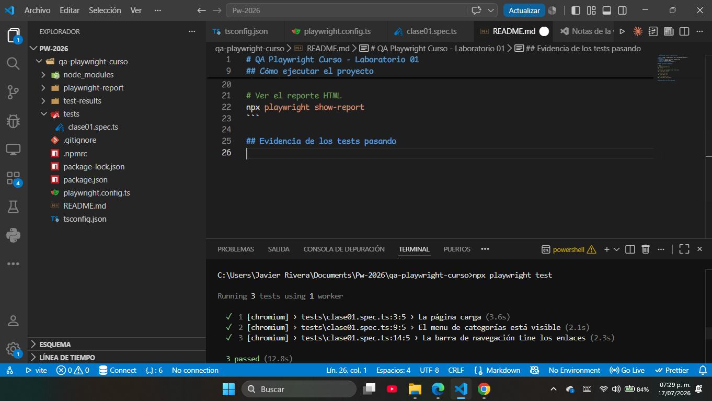
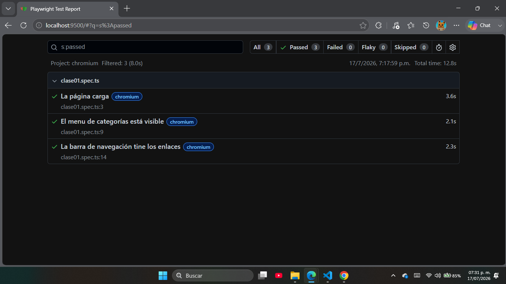
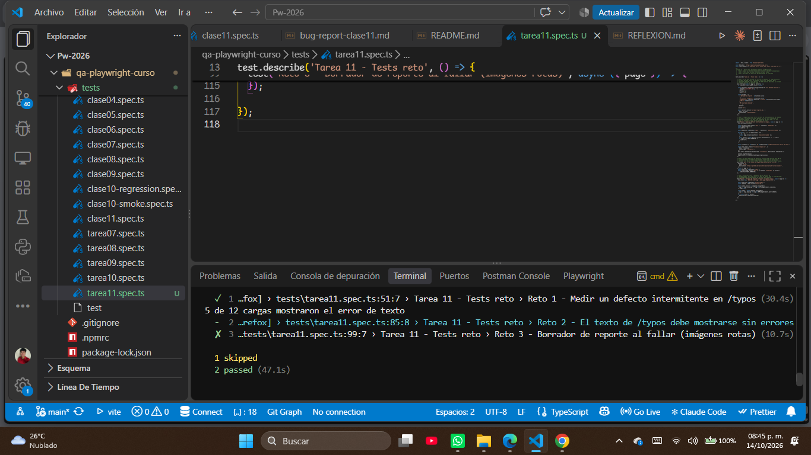
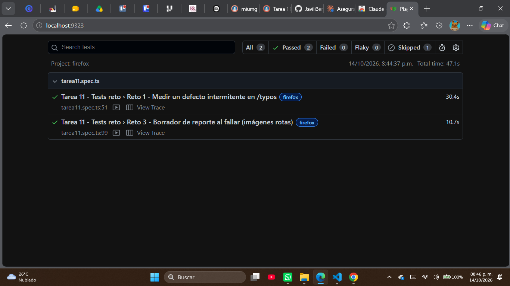
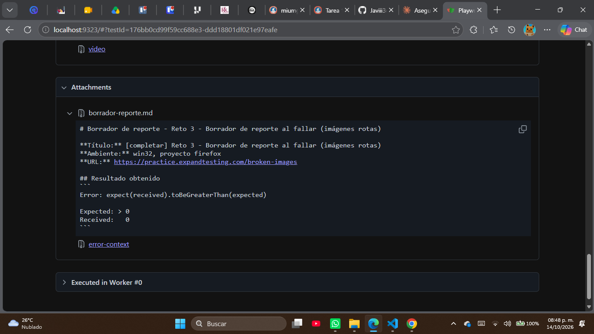

# QA Playwright Curso - Laboratorio 01

**Curso:** 048 - Aseguramiento de la Calidad del Software
**Módulo:** I
- **Nombre:** Javier José Luis Rivera Pérez
- **Carné:** 1790-22-10552
- **Versión de Node.js:** v22.17.1

## Cómo ejecutar el proyecto

```bash
# Instalar dependencias
npm install

# Descargar los navegadores de Playwright
npx playwright install

# Ejecutar los tests
npx playwright test

# Ver el reporte HTML
npx playwright show-report
```

## Evidencia de los tests pasando
Ejecución en terminal con los 3 tests en verde (passed):



Reporte HTML de Playwright:



## Defectos reportados (Clase 11)
- **BR-CLASE11-001** - Imágenes rotas en /broken-images: asdf.jpg y hjkl.jpg responden 404.
  - Issue: https://github.com/Javiii3er/qa-playwright-curso/issues/1
  - Reporte: [reportes/bug-report-clase11.md](./reportes/bug-report-clase11.md)
  - Test que lo documenta: `tests/clase11.spec.ts` (tag `@bug`, usa `test.fail()`)

## Tarea 11 - Tests reto
Archivo: `tests/tarea11.spec.ts` (`npx playwright test tests/tarea11.spec.ts --project=firefox` -> 2 passed, 1 skipped).
- **Reto 1:** mide el defecto intermitente de `/typos` (5 de 12 cargas con error) con `testInfo.attach` y una anotación.
- **Reto 2:** `test.fixme` con anotación de tipo `issue`, omitido mientras el defecto siga abierto.
- **Reto 3:** `afterEach` que adjunta un borrador de reporte en Markdown cuando el test tiene errores.
- Reporte del defecto de `/typos`: [reportes/bug-report-typos-clase11.md](./reportes/bug-report-typos-clase11.md)
- Issue del defecto de `/typos`: https://github.com/Javiii3er/qa-playwright-curso/issues/2




