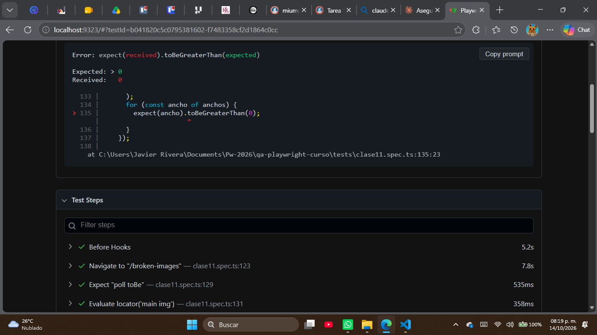
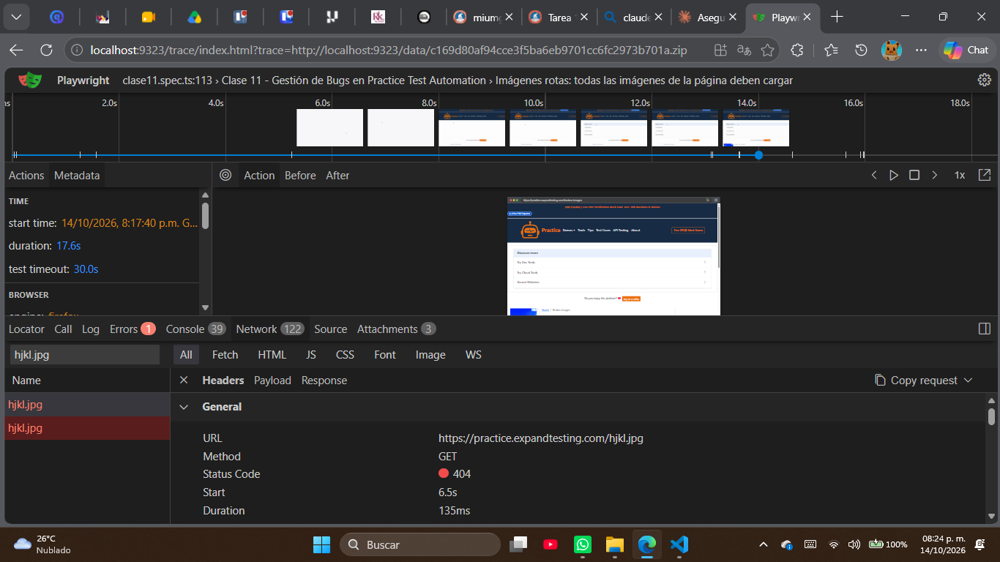

# Bug Report - BR-CLASE11-001

**Título:** Imágenes rotas en /broken-images: asdf.jpg y hjkl.jpg responden 404
**Fecha:** 14/10/2026
**Reportado por:** Javier José Luis Rivera Pérez
**Ambiente:** Windows (versión 10.0.26200), Firefox ejecutado con Playwright

## Descripción
En la página `/broken-images` de practice.expandtesting.com, dos de las imágenes
listadas (`asdf.jpg` y `hjkl.jpg`) no cargan: el servidor responde con un
estado 404 Not Found en lugar de devolver el archivo de imagen.

## Severidad: Media
Ninguna función de la aplicación se rompe (no es un bloqueante de negocio),
pero el defecto es visible directamente para el usuario: donde debería verse
una imagen aparece el ícono de "imagen rota" del navegador.

## Prioridad: P3
No impide usar la aplicación ni afecta un flujo crítico (login, formularios,
etc.); puede corregirse en un ciclo normal sin urgencia.

## Frecuencia: Siempre
El defecto se reproduce el 100% de las veces que se visita la página; no es
intermitente.

## Pasos para reproducir
1. Ir a `https://practice.expandtesting.com/broken-images`.
2. Observar las imágenes listadas dentro de `main img`.
3. Inspeccionar la pestaña Network (o revisar `naturalWidth` de cada ``).

## Resultado esperado
Todas las imágenes de la página cargan correctamente (`naturalWidth > 0` y la
petición de red responde 200).

## Resultado obtenido
Las imágenes `asdf.jpg` y `hjkl.jpg` responden 404; su `naturalWidth` es 0 y
se muestran como imagen rota.

## Evidencia
- Petición 1: `GET https://practice.expandtesting.com/asdf.jpg` → 404 (Network, Trace Viewer de Playwright).
- Petición 2: `GET https://practice.expandtesting.com/hjkl.jpg` → 404 (Network, Trace Viewer de Playwright).
- Error del test en el reporte HTML: `Expected: > 0` / `Received: 0` en `tests/clase11.spec.ts:135`.
- Test automatizado: `tests/clase11.spec.ts` → "Imágenes rotas: todas las imágenes de la página deben cargar" (tag `@bug`), que usa `test.fail()` mientras el defecto siga abierto.
- Capturas:
  
  
  
- Issue en GitHub: https://github.com/Javiii3er/qa-playwright-curso/issues/1

## Notas adicionales
Defecto de la propia aplicación de práctica (practice.expandtesting.com), no
del código de pruebas. El test que lo documenta usa `test.fail(true, ...)`
para que la suite siga en verde; si alguien corrige el defecto en la
aplicación, ese mismo test pasará a fallar y avisará que `test.fail()` ya
debe quitarse.