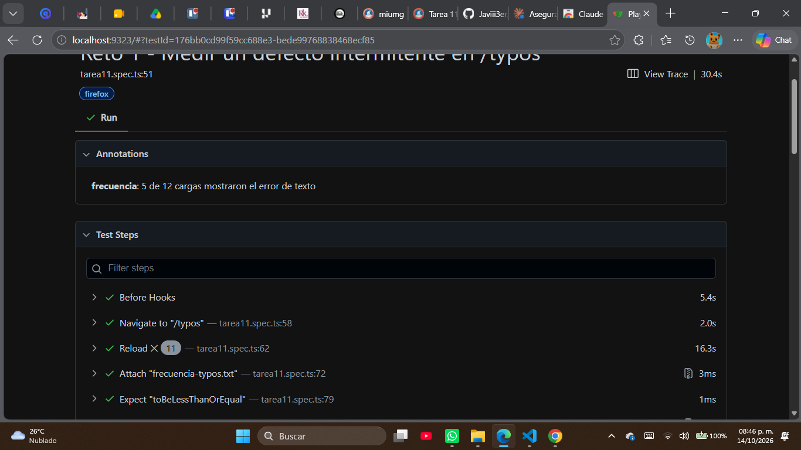

# Bug Report - BR-CLASE11-002

**Título:** Error de texto aleatorio en /typos: el párrafo aparece con un typo en algunas cargas
**Fecha:** 14/10/2026
**Reportado por:** Javier José Luis Rivera Pérez
**Ambiente:** Windows (versión 10.0.26200), Firefox ejecutado con Playwright

## Descripción
En `https://practice.expandtesting.com/typos`, el texto "Sometimes you'll see a typo, other times you won't." aparece alterado en algunas cargas de la página y correcto en otras.

## Severidad: Baja
Es un error cosmético de texto que no impide usar la página.

## Prioridad: P4
La propia página indica que el typo se introduce de forma aleatoria, por lo que puede ser intencional; no requiere corrección urgente.

## Frecuencia: Intermitente
En una medición automatizada de 12 recargas, 5 mostraron el texto con error.

## Pasos para reproducir
1. Ir a `https://practice.expandtesting.com/typos`.
2. Leer el párrafo que empieza con "Sometimes".
3. Recargar la página varias veces y comparar el texto con el esperado.

## Resultado esperado
El texto se muestra siempre igual: "Sometimes you'll see a typo, other times you won't."

## Resultado obtenido
En algunas cargas el texto no coincide con el esperado (5 de 12 en la medición).

## Evidencia
- Test: `tests/tarea11.spec.ts` (Reto 1), que adjunta `frecuencia-typos.txt` al reporte HTML y deja la anotación `frecuencia`.
  
- Test pendiente: Reto 2, marcado con `test.fixme` y anotación `issue` hasta que el defecto se corrija.
- Issue en GitHub: https://github.com/Javiii3er/qa-playwright-curso/issues/2

## Notas adicionales
La propia página de práctica declara que introduce el typo de forma aleatoria en cada carga.
